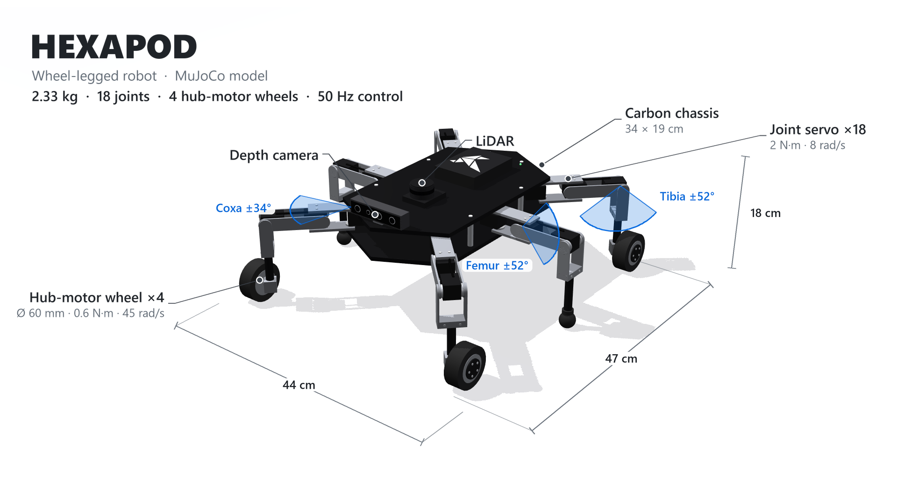

# Hexapod Control with Deep Reinforcement Learning

**English** | [Türkçe](README_TR.md)



[▶ Demo video](media/hexapod_demo_web.mp4)

This project trains a six-legged hybrid wheel-legged robot with the PPO algorithm in MuJoCo MJX.

The robot has 18 joints in total and hub-motor wheels on its four corner legs. A single neural network controls all
of the robot's joints and its four wheels together. On flat ground the robot drives on its wheels, and it uses its
legs to get over obstacles.

During training, random failures are injected into the robot's joints and locomotion mechanisms to make it robust
against failures. Single-joint failures, leg losses and wheel failures are simulated. As a result, when the robot
loses some of its joints or locomotion mechanisms, it keeps moving with the limbs it has left.

## Project Summary

- **Hybrid locomotion.** Wheels and a tripod gait work together. The speed can reach about 1.25 m/s.
- **Rough terrain.** There are 8 terrain types, each with 8 difficulty levels.
- **Fault tolerance.** Training includes random motor failures.
  - When all wheels fail, the robot switches to a six-legged tripod gait.
  - When one leg loses its driving power, the robot keeps walking on the remaining five.
- **Realistic motor model.** Torques follow torque–speed curves: 2 N·m and 8 rad/s for the joints, 0.6 N·m and
  45 rad/s for the wheels. Joint speeds stay below the 8 rad/s limit.

## Quick start

Tested on Python 3.12.

```bash
python -m venv .venv
.venv\Scripts\activate          # Linux / macOS: source .venv/bin/activate
pip install -r requirements.txt
python play.py
```

| Key | Action |
|---|---|
| ↑ / ↓ | forward / back, 0.4 m/s (walk) |
| Ctrl + ↑ | fast, 1.3 m/s (wheels + steps) |
| ← / → | turn left / right |
| Shift + ← / → | strafe |
| 1 … 6 | turn off a leg's motors (LF LM LR RF RM RR) |
| 7 / 8 | all wheels limp / locked |
| 9 | next terrain type |
| Page Up / Page Down | terrain level |
| Backspace | reset |
| P | hide / show the on-screen info |

Options:
- `--quality`: shadows and full-resolution terrain.
- `--free-camera`: free camera instead of the chase camera.
- `--panel`: MuJoCo's own side panels.
- `--stand`: no policy, the robot only stands.

Arrow-key driving uses the Windows keyboard API. On other systems the viewer opens, but the robot only stands.

## Training

**In a notebook environment**

Import `notebooks/train.ipynb` into the notebook environment you use and run it. When training finishes, download the
generated `policy.npz` file and copy it to `models/policy.npz`.

**Locally**

```bash
pip install "jax[cuda12]==0.6.2"
python train.py --steps 300_000_000 --video
python train.py --resume checkpoints    # continue from the latest checkpoint
python train.py --smoke                 # few-minute end-to-end test on CPU
python play.py --policy policy.npz      # drive the newly trained policy
```

To change the robot or the terrain, edit `hexapod/model.py` and run `python -m hexapod.model`. This command
regenerates the files in `assets/`.

The `models/policy.npz` file in the repository is the policy shown in the video, trained for 300 million steps.

## How it works

**Robot** (`hexapod/model.py`):
- The robot weighs 2.33 kg. Each leg has 3 joints, so the robot has 18 joints and 4 wheels in total. The wheels are
  located at the tips of the corner legs and have a radius of 3 cm.

**Action space** (`hexapod/core.py`):
- The robot is controlled by a single neural network.
- The control loop runs at 50 Hz and the physics simulation at 250 Hz. Each step produces 22 outputs: a target angle
  for each of the 18 joints (±0.6 rad) and a target speed for each of the 4 wheels (±35 rad/s). The joints are driven
  to their target angles with PD control. Motor torques are limited by torque–speed curves.

**Observation space**:
- The control network receives the estimated body velocity, IMU readings, joint angles and velocities, wheel speeds,
  the previous command, the target velocity command and the phase of the gait rhythm. The last 10 steps of this
  information are fed to the network. In addition, a 13 × 5 point height map of the ground around the body is
  provided. (In simulation this is read directly from the simulator; on a real robot it could come from a depth
  camera or a LiDAR sensor.)
- The critic network used during training also receives the true velocity, foot contacts, failure states and ground
  slope from the simulation. This information is used only during training.

**Reward function:**
- Velocity and turn-rate tracking.
- Upright body.
- Smoothness and effort.
- Tripod gait rhythm tied to a 1.5–2 Hz clock.
- Sufficient foot clearance, and a penalty for short hops.
- Standing posture.

**Curriculum** (`hexapod/mjx_env.py`):
- The training environment is 18 × 18 m and consists of 8 different terrain types. Each terrain type has 8 difficulty
  levels.
- Robots start on the easy levels and move up one level after traveling more than 1 m without falling. They move down
  one level if they fall or do not make enough progress.
- Half of the episodes start at the edge of a tile, so the robot has to climb first.

**Randomization:**
- To prevent overfitting to a single environment, the conditions are changed in every episode. Ground friction and the
  noise added to the velocity estimate are chosen randomly. Target velocity and turn commands are renewed every
  4–6 seconds. In 75% of the episodes a failure is introduced at the start or later on: a single motor, one or two
  legs, all wheels, or all wheels together with one leg can fail.

## Results

The trained controller was evaluated in CPU MuJoCo, with the following results:

| | |
|---|---|
| Top speed | 1.25 m/s (wheels + legs) |
| Speed tracking at 0.3 / 0.6 / 1.0 m/s | 0.31 / 0.66 / 0.98 m/s |
| Heading drift when going straight | < 1°/s |
| Terrain | all 8 levels of all 8 types, no falls |
| Wheels locked or limp | six-legged tripod gait, 0.8 m/s |
| Gait rhythm adherence | 93–98% |
| Peak joint speed | 7.9 rad/s (motor limit 8 rad/s) |
