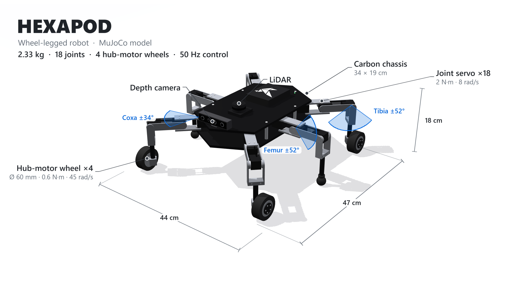

# Derin Pekiştirmeli Öğrenme ile Hexapod Kontrolü

[English](README.md) | **Türkçe**



[▶ Tanıtım videosu](media/hexapod_demo_web.mp4)

Bu projede altı bacaklı hibrit tekerlekli bir robotun MuJoCo MJX ortamında PPO algoritması kullanılarak eğitilmesi amaçlanmıştır.

Robot, dört köşe bacağında bulunan göbek motorlu tekerlekler ve toplam 18 eklemden oluşmaktadır. Sinir ağı robotun tüm eklemlerini ve dört tekerleğini birlikte kontrol etmektedir. Robot düz zeminlerde tekerleklerini kullanarak ilerlerken engelleri bacaklarını kullanarak aşabilmektedir.

Eğitim sürecinde robotun eklem ve hareket mekanizmalarında rastgele arızalar oluşturularak arızalara karşı dayanıklılık kazandırılması hedeflenmiştir. Bu kapsamda tekil eklem arızaları, bacak kayıpları ve tekerlek arızaları simüle edilmiştir. Böylece robotun bazı eklem veya hareket mekanizmalarını kaybettiği durumlarda mevcut uzuvlarını kullanarak hareketini sürdürmesi sağlanmıştır.

## Proje Özeti

- **Hibrit hareket.** Tekerler ve üçlü (tripod) yürüyüş birlikte çalışır. Hız yaklaşık 1,25 m/s'ye kadar çıkabilmektedir.
- **Engebeli arazi.** Her birinin 8 zorluk seviyesi olan 8 arazi tipi bulunmaktadır.
- **Arızaya dayanıklılık.** Eğitimde rastgele motor arızaları bulunmaktadır.
  - Bütün tekerler arızalanınca robot altı bacaklı üçlü yürüyüşe geçer.
  - Bir bacağın itme gücü engellenince kalan beş bacakla yürümeye devam eder.
- **Gerçekçi motor modeli.** Torklar tork–hız eğrilerini izler. Eklemlerde 2 N·m ve 8 rad/s, tekerlerde 0,6 N·m ve
  45 rad/s. Eklem hızları 8 rad/s sınırının altında kalır.

## Hızlı başlangıç

Python 3.12 üzerinde test edilmiştir.

```bash
python -m venv .venv
.venv\Scripts\activate          # Linux / macOS: source .venv/bin/activate
pip install -r requirements.txt
python play.py
```

| Tuş | İşlev |
|---|---|
| ↑ / ↓ | ileri / geri, 0,4 m/s (yürüyüş) |
| Ctrl + ↑ | hızlı, 1,3 m/s (teker + adım) |
| ← / → | sola / sağa dönüş |
| Shift + ← / → | yana kayma |
| 1 … 6 | bir bacağın motorlarını kapatır (LF LM LR RF RM RR) |
| 7 / 8 | bütün tekerler boşta / kilitli |
| 9 | sonraki arazi tipi |
| Page Up / Page Down | arazi seviyesi |
| Backspace | Reset |
| P | ekran bilgilerini gizler / gösterir |

Seçenekler:
- `--quality`: gölgeler ve tam çözünürlüklü arazi.
- `--free-camera`: takip kamerası yerine serbest kamera.
- `--panel`: MuJoCo'nun kendi yan panelleri.
- `--stand`: politika yok, robot yalnızca ayakta durur.

Ok tuşlarıyla sürüş Windows klavye API'sini kullanır. Diğer sistemlerde görüntüleyici açılır ama robot yalnızca
ayakta durur.

## Eğitim

**Notebook Ortamında**

Çalıştığınız notebook ortamına `notebooks/train.ipynb` dosyasını içe aktarın ve çalıştırın. Eğitim bitince oluşturulan
`policy.npz` dosyasını indirip `models/policy.npz` konumuna kopyalayın.

**Yerelde**

```bash
pip install "jax[cuda12]==0.6.2"
python train.py --steps 300_000_000 --video
python train.py --resume checkpoints    # en son kayıttan devam eder
python train.py --smoke                 # CPU'da birkaç dakikalık uçtan uca test
python play.py --policy policy.npz      # yeni eğitilen politikayı sürer
```

Robotu ya da araziyi değiştirmek için `hexapod/model.py` dosyasını düzenleyip `python -m hexapod.model` komutunu
çalıştırın. Bu komut `assets/` içindeki dosyaları yeniden üretir.

Repoda bulunan `models/policy.npz` videoda gösterilen politikadır ve 300 milyon adım eğitilmiştir.

## Nasıl çalışır

**Robot** (`hexapod/model.py`):
- Robot 2,33 kg ağırlığındadır. Her bacakta 3 eklem bulunmaktadır. Robot toplamda 18 eklem ve 4 tekerlekten
oluşmaktadır. Tekerlekler köşe bacakların uçlarında yer almakta olup 3 cm yarıçapındadır.

**Aksiyon Uzayı** (`hexapod/core.py`):
- Robot tek bir sinir ağı ile kontrol edilmektedir.
- Kontrol döngüsü 50Hz, fizik simülasyonu 250Hz frekansında çalışmaktadır. Her adımda 22 çıktı üretilmektedir. (18 eklem
için hedef açı değeri (±0,6 rad) ve 4 tekerlek için hedef hız (±35 rad/s)). Eklemler hedef açı değerine PD kontrol yöntemiyle
getirilmektedir. Motor torkları, tork-hız eğrileriyle sınırlandırılmıştır.

**Gözlem Uzayı**:
- Kontrol ağı girdi olarak; tahmini gövde hızı, IMU sensör bilgisi, eklem açıları ve hızları, tekerlek hızları, bir önceki komut,
hedef hız komutu ve yürüyüş ritminin fazını almaktadır. Bu bilgilerin son 10 adımlık geçmişi ağı beslemektedir. Buna ek olarak robot
gövde çevresinde zeminin 13x5 noktalı yükseklik haritası verilmektedir. (Bu bilgi simülasyon ortamında doğrudan simülasyondan alınır, gerçek
bir robotta derinlik kamerası veya lidar sensöründen alınabilir.)
- Eğitimde kullanılan kritik ağına simülasyondan alınan gerçek hız, ayak temasları, arıza durumları ve zemin eğimi bilgileri verilmektedir.
Bu bilgiler yalnızca eğitim aşamasında kullanılmaktadır.

**Ödül Fonksiyonu:**
- Hız ve dönüş takibi.
- Dik gövde.
- Yumuşaklık ve efor.
- 1,5–2 Hz'lik bir saate bağlı üçlü yürüyüş ritmi.
- Ayakların yerden yeterince kalkması ve kısa sıçramalara ceza.
- Duruş pozu.

**Müfredat** (`hexapod/mjx_env.py`):
- Eğitim ortamı 18x18m boyutundadır ve 8 farklı arazi tipinden oluşmaktadır. Her arazi tipi için 8 zorluk seviyesi bulunmaktadır.
- Robotlar kolay arazi seviyesinden başlatılır ve devrilmeden 1 m'den fazla yol alınca bir seviye yükselir. Devrilince ya da yeterince ilerleyemeyince bir seviye düşer.
- Bölümlerin yarısı bir karonun kenarında başlar. Böylece robot önce tırmanmak zorunda kalır.

**Rastgeleleştirme:**
- Tek bir ortama aşırı uyumu engellemek için ortam koşulları her denemede değiştirilir. Zemin sürtünmesi, hız tahminine eklenen gürültü
rastgele belirlenmektedir. Hedef hız ve dönüş komutları 4-6 saniyede bir yenilenmektedir. Denemelerin %75'inde başlangıçta veya sonrasında
arıza oluşturulmaktadır. Tek bir motor, bir veya 2 bacak, tüm tekerlekler veya tekerleklerle birlikte bir bacak arızalanabilmektedir.

## Sonuçlar

Eğitilen kontrol modeli CPU MuJoCo'da ölçülmüş ve aşağıdaki sonuçlar elde edilmiştir:

| | |
|---|---|
| En yüksek hız | 1,25 m/s (teker + bacak) |
| 0,3 / 0,6 / 1,0 m/s'de hız takibi | 0,31 / 0,66 / 0,98 m/s |
| Düz giderken yön sapması | < 1°/sn |
| Arazi | 8 tipin 8 seviyesinin hepsi, devrilme yok |
| Tekerler kilitli ya da boşta | altı bacaklı üçlü yürüyüş, 0,8 m/s |
| Yürüyüş ritmine uyum | %93–98 |
| En yüksek eklem hızı | 7,9 rad/s (motor sınırı 8 rad/s) |
